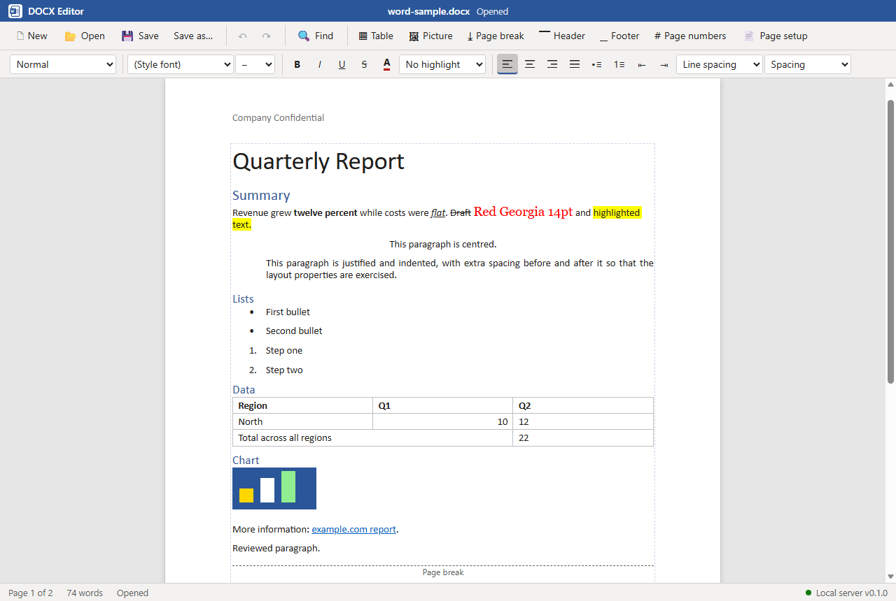
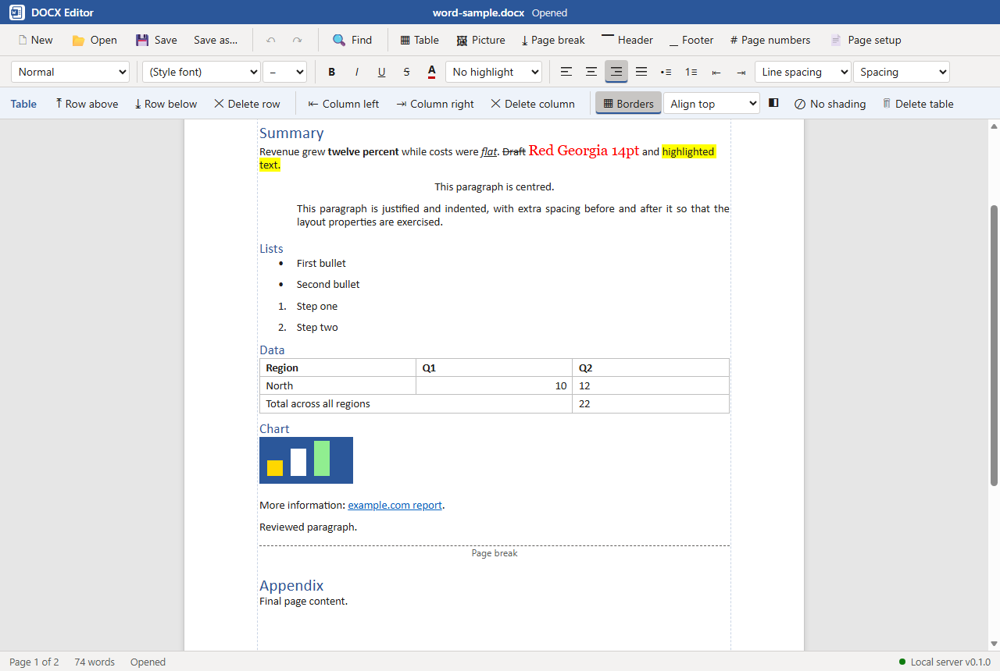
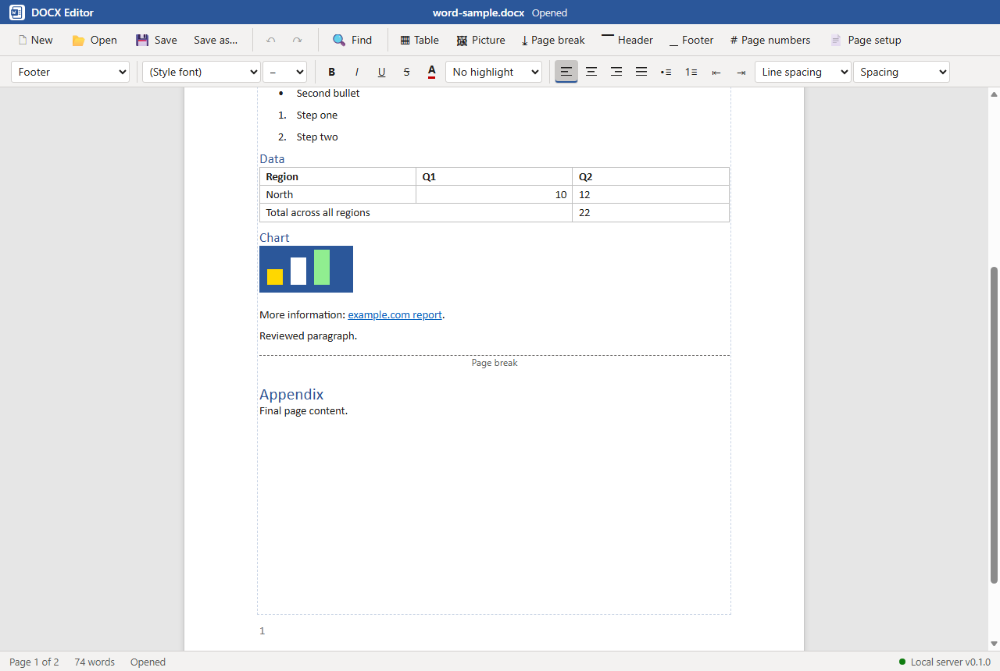
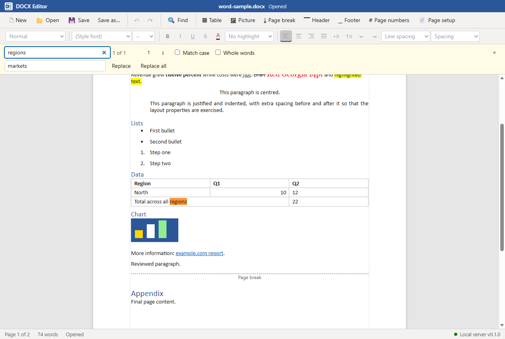
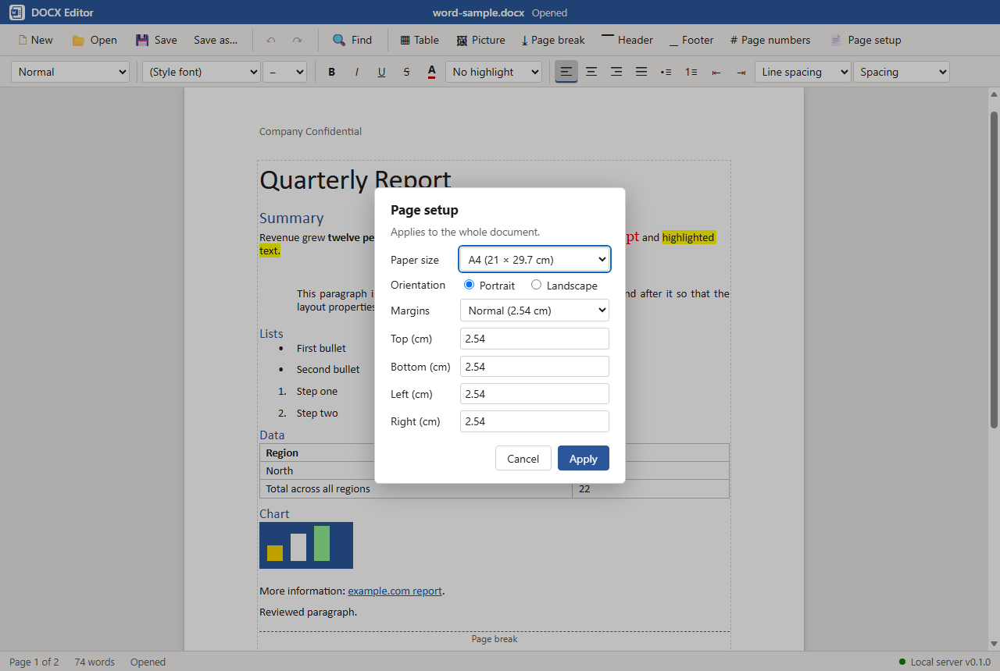
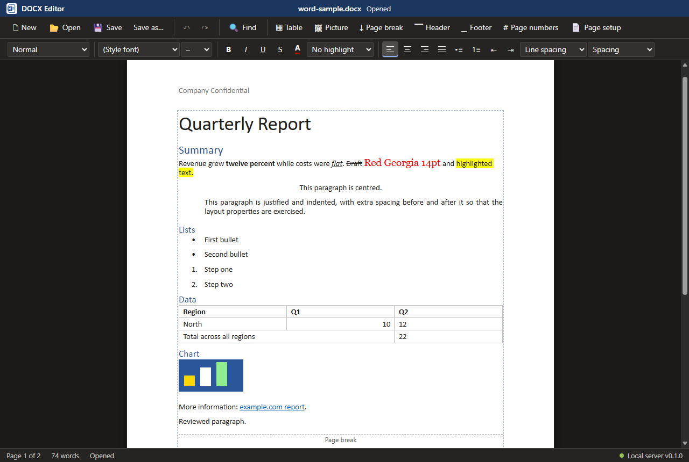
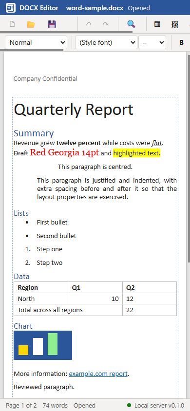

# DOCX Editor

A local, web-based editor for Microsoft Word `.docx` documents. A small Rust (Axum/Tokio) server runs on your computer and serves a Word-style interface built with plain HTML, CSS and JavaScript. Nothing is sent over the internet, and parts of a document you don't edit are saved back exactly as they were.

You can create a blank document or open an existing `.docx`, edit and format its text and paragraphs, work with lists, tables, pictures, headers, footers, page numbers, page setup and page breaks, undo and redo, find and replace, and save it again without losing anything you didn't touch. Unsaved changes are kept as a local draft and can be recovered after a crash.

## Screenshots

| | |
| --- | --- |
|  |  |
| Editing a document made by Word: styles, character formatting, lists, a table and a picture. | In a table the **Table** toolbar appears (rows, columns, borders, cell alignment and shading). |
|  |  |
| Headers are edited in place, in the top margin. | Footers too; here the footer holds a page number field. |
|  |  |
| Find and replace (`Ctrl+H`) highlights matches in the text, tables, header and footer. | Page setup: paper size, orientation and margins. |
|  |  |
| The interface follows the system's dark theme (the page stays white, like paper). | At phone width the toolbars become single scrolling rows. |

More: [phone, dark](docs/screenshots/phone-dark.png) · [page setup on a phone](docs/screenshots/phone-page-setup.png) · [no document open](docs/screenshots/welcome.png). The screenshots are taken from the real interface by `node tests/browser/screenshots.mjs`.

## Getting started

### 1. Install the prerequisites

You need **Rust 1.86 or newer** (edition 2024) and a modern browser. Node.js is only needed to run the frontend and browser tests.

| System | Steps |
| --- | --- |
| **Windows 10/11** | Install Rust with [rustup](https://rustup.rs/) (`rustup-init.exe`). When it asks, let it install the *Visual Studio C++ Build Tools* (the "Desktop development with C++" workload); Rust needs its linker. |
| **macOS** | Install the command line tools with `xcode-select --install`, then Rust: `curl --proto '=https' --tlsv1.2 -sSf https://sh.rustup.rs \| sh`. |
| **Linux** | Install a C toolchain (`sudo apt install build-essential` on Debian/Ubuntu, `sudo dnf install gcc` on Fedora), then Rust: `curl --proto '=https' --tlsv1.2 -sSf https://sh.rustup.rs \| sh`. |

Check with `cargo --version` (1.86 or newer). If you already have Rust, `rustup update` brings it up to date.

Browsers: Microsoft Edge, Google Chrome and other Chromium-based browsers save straight back to the file you opened. Firefox and Safari work too; there, saving downloads the file.

### 2. Build and run

Get the source (clone or unpack it), open a terminal in its folder and run:

```sh
cargo run --release
```

The first build downloads the dependencies and takes a minute or two; later starts are immediate. When it prints `DOCX editor running at http://localhost:8080`, the editor opens in your default browser.

### 3. Open the editor

If no browser window opens (for example over a remote session), go to <http://localhost:8080> yourself. Choose **New** for a blank document, or **Open** (or drop a `.docx` file on the page) to edit one of yours. Press `Ctrl+C` in the terminal to stop the editor.

The built program is self-contained, since the interface is embedded in it. You can copy `target/release/docx-editor` (`docx-editor.exe` on Windows) anywhere and run it directly.

| Option | Description |
| --- | --- |
| `-p`, `--port <PORT>` | Port to listen on (default `8080`; `0` picks any free port). Also settable with `DOCX_EDITOR_PORT`. |
| `--no-open` | Don't open the browser automatically. |
| `-h`, `--help` | Show help. |
| `-V`, `--version` | Show the version. |

For example `cargo run --release -- --port 9000 --no-open`. Set `RUST_LOG=debug` for more detailed logs. The server only listens on `127.0.0.1`, so other computers can't reach it.

### Troubleshooting

- **"port 8080 is already in use"**: another program (or another copy of the editor) uses port 8080. Start with `--port 9000`, or `--port 0` to pick a free port; the address is printed.
- **The page says the local server is unavailable** (red dot in the status bar): the editor was stopped. Start it again; unsaved changes are reopened from their draft.
- **`linker 'link.exe' not found`** (Windows) or **`linker 'cc' not found`** (macOS/Linux): install the C++ build tools or C toolchain from step 1.
- **"The file is password-protected or uses the old .doc format"**: open it in Word, remove the password or save it as `.docx`.

## Using the editor

### Opening and saving

- **Open:** choose a `.docx`, `.docm`, `.dotx` or `.dotm` file. The browser reads it and sends it to the local server, which keeps it in memory.
- **Save** (`Ctrl+S`): in Edge/Chrome, writes back to the file you opened (or asks where to save a new document). Elsewhere, the document is downloaded.
- **Save As** (`Ctrl+Shift+S`): asks for a new file name and location.
- Before a file is handed to the browser, the editor reads it back and checks that it opens and that every part it rewrote is well-formed; if not, nothing is written and you are told why. When the file can't be written (it is open in another program, read-only, or permission was refused), the message says so and suggests Save As.

What is preserved: everything. Parts of the file that were not edited are written back byte-for-byte (styles, headers, footers, images, comments, footnotes, numbering, custom XML, settings, …), and inside the main document only edited paragraphs change. See [ARCHITECTURE.md](ARCHITECTURE.md#preservation) for the details.

### Editing

- Click in the page and type. Text you type takes the formatting of the text around it; unchanged runs keep their exact formatting.
- **Enter** starts a new paragraph with the same style (a heading continues as a heading), **Shift+Enter** inserts a line break, **Ctrl+Enter** a page break.
- **Backspace** at the start of a paragraph joins it to the previous one; **Delete** at the end joins the next one. Selecting across paragraphs and typing or deleting replaces the selection.
- **Tab** types a tab. In a table it moves to the next cell (Shift+Tab to the previous one) and adds a row after the last cell; at the start of a list item it moves the item a level down (Shift+Tab up).
- **Paste** inserts plain text; each line becomes a paragraph.
- Pictures, hyperlinks, page breaks, fields and other content the editor doesn't edit are shown as protected objects: you can type around them and delete pictures, links and page breaks, but not edit inside them. Field codes (such as page numbers) and comment markers are always kept.
- The title bar shows "Unsaved changes" until you save, and closing the tab asks first.
- **Undo** (`Ctrl+Z`) and **redo** (`Ctrl+Y` or `Ctrl+Shift+Z`) work for every change; a run of typing in one paragraph is one step. The last 200 steps are kept.
- **Find and replace** (`Ctrl+F`, `Ctrl+H`): Enter and Shift+Enter move between matches; *Match case* and *Whole words* narrow the search. Replace all is undone in one step.
- If the local server can't be reached for a moment, what you type stays on the page and is sent when it is back.

### Formatting

The formatting toolbar shows the formatting at the cursor and applies changes to the selection (or, for character formatting with nothing selected, to the word at the cursor):

| Control | Shortcut |
| --- | --- |
| Paragraph style (Normal, Title, Heading 1–3 and the document's own styles) | `Ctrl+Alt+1/2/3` headings, `Ctrl+Alt+0` Normal |
| Font and size | `Ctrl+]` / `Ctrl+[` larger / smaller |
| Bold, italic, underline, strikethrough | `Ctrl+B`, `Ctrl+I`, `Ctrl+U`, `Ctrl+Shift+X` |
| Text colour and highlight colour | |
| Align left, centre, right, justify | `Ctrl+Shift+L/E/R/J` |
| Bulleted and numbered lists | `Ctrl+Shift+8`, `Ctrl+Shift+7` |
| Decrease / increase indent (changes the list level in lists) | `Ctrl+Shift+M`, `Ctrl+M` |
| Line spacing and paragraph spacing | |

Heading and title styles a document doesn't define are added to it with Word's standard look. Lists reuse the document's own list definitions where it has them. Formatting is written as ordinary Word properties, so Word shows it the same way.

### Tables, pictures and page layout

| Button | What it does |
| --- | --- |
| Table | Inserts a table (choose rows and columns) at the cursor, spread over the text width with single borders. |
| Picture | Inserts a PNG, JPEG, GIF or BMP picture at the cursor, scaled down to the text width if needed. You can also drop a picture file on the page. |
| Page break | Starts a new page at the cursor (`Ctrl+Enter`). |
| Header / Footer | Puts the cursor in the header or footer, adding an empty one if the document has none. Double-clicking the empty top or bottom margin does the same. |
| Page numbers | Adds the page number (optionally "Page 1 of 3") to the footer or header, left, centred or right, and can set the first page's number. |
| Page setup | Paper size (A4, Letter, Legal, A5, A3), orientation and margins for the whole document. |

**Tables:** while the cursor is in a table, the **Table** toolbar can insert rows and columns, delete them or the table, show or hide borders, align a cell's text and shade cells. **Pictures:** click a picture to select it, drag the square handle at its corner to resize it, or press Delete to remove it.

### Draft recovery

While a document has unsaved changes, the editor keeps a copy of it a couple of seconds after each change in the browser's own storage (IndexedDB). The copy never leaves the computer and is deleted when you save or discard the changes. If the browser, the tab or the computer stops before you save, the next start offers to **Recover** the draft. If the editor server was restarted while a document was open, the document is reopened from its draft automatically.

## Keyboard and accessibility

Everything can be done with the keyboard, and the interface is built for screen readers:

| Keys | What they do |
| --- | --- |
| `Tab` / `Shift+Tab` | Move between the toolbars and the page. Each toolbar is a single stop. |
| Arrow keys, `Home`, `End` | Move between the controls of a toolbar. |
| `Alt+F10` | Go to the formatting toolbar. `Escape` goes back to the page. |
| `F6` / `Shift+F6` | Move between the toolbars, the find bar, messages and the page. |
| `Ctrl+O`, `Ctrl+S`, `Ctrl+Shift+S` | Open, save, save as. |
| `Ctrl+F`, `Ctrl+H`, `Escape` | Find, find and replace, close the find bar. |
| `Enter` in a dialog, `Escape` | Confirm the dialog, cancel it. The focus returns to the page. |

- The toolbars are ARIA toolbars. Toggle buttons report whether they are on (`aria-pressed`), buttons announce their shortcuts (`aria-keyshortcuts`), and every control has a name.
- Results and errors are read out through live regions: opening, creating and saving a document, undo and redo, find results, and messages. Errors interrupt; everything else waits its turn.
- The interface follows the system's light or dark theme, and its text has at least 4.5:1 contrast in both. Every control shows the keyboard focus. Nothing animates, and reduced-motion settings are respected.
- At narrow widths (phones, split screens) the toolbars become single rows that scroll, and tables shrink to fit the page.

## Limitations

The editor is meant for real documents, but it is not Word. The main things it doesn't do:

- **No pagination.** The document is one continuous sheet with dashed lines where each page would end; the page count in the status bar is an estimate. Headers and footers are shown once, at the top and bottom of the sheet. Word paginates the saved file normally.
- **Headers and footers:** only the document's main header and footer are shown and edited; first-page and even-page headers are kept but not shown.
- **Tables:** no merging or splitting of cells, no column resizing by dragging, no per-cell borders, and tables inside tables are read-only. Selections can't span a table and the text around it (so *select all* + Delete in a document with tables is refused).
- **Pictures:** inline only. Floating pictures are shown inline and kept as they are. There is no cropping, rotation or text wrapping, no resizing with the keyboard, and no pasting pictures from the clipboard; insert or drop the file instead.
- **Page setup** applies to the whole document (every section).
- **Not editable, but kept:** text inside hyperlinks, fields, content controls, text boxes, footnotes and comments; tracked changes. Find and replace doesn't search these either.
- **Pasting** inserts plain text only.
- **Undo history** lives in the server's memory: it is lost when the document is closed or the server restarts (the document itself is recovered from its draft).
- **Files:** password-protected files and old binary `.doc` files can't be opened. Documents are kept in memory while open (at most 32, 100 MiB each). The ZIP container is rebuilt on save: part contents are identical, but compressed sizes may differ.

[ARCHITECTURE.md](ARCHITECTURE.md#limitations) has the complete, technical list.

## Development

```sh
cargo test                                   # Rust unit and integration tests (engine and server)
cargo clippy --all-targets -- -D warnings    # lints
cargo fmt --check                            # formatting
npm test                                     # frontend unit tests (Node's built-in runner; nothing to install)

cargo build --release
npm run test:browser    # headless Edge/Chrome: the smoke test (every feature on a new document and a Word document,
                        # drafts, offline typing) and the accessibility test (keyboard only, focus, dialogs,
                        # announcements, accessibility tree, contrast in both themes, phone layout)
npm run test:perf       # opens a 330-page document and times typing, Enter, formatting, undo, find and saving
node tests/browser/screenshots.mjs   # retakes the screenshots in docs/screenshots/
```

The browser tests find Edge or Chrome automatically; set `BROWSER` to the executable otherwise. The smoke test can save screenshots (`SCREENSHOT_DIR=<folder>`) and the documents it edited (`SAVE_DIR=<folder>`).

Word compatibility checks (Windows with Microsoft Word installed):

```powershell
./scripts/make-word-fixture.ps1      # regenerate the Word-made test document (tests/fixtures/word-sample.docx)
cargo run -p docx-engine --example docx_tool -- edit tests/fixtures/word-sample.docx target/edited.docx --text 2 "New text" --align 1 center
./scripts/verify-with-word.ps1 tests/fixtures/word-sample.docx target/edited.docx
```

`docx_tool` can also print a document's structure (`inspect`), check that its XML is in schema order (`check`) and apply edits as the editor sends them (`edit <in> <out> --json edits.json`, `new <out> --json edits.json`).

See [ARCHITECTURE.md](ARCHITECTURE.md) for how the application is organized.
